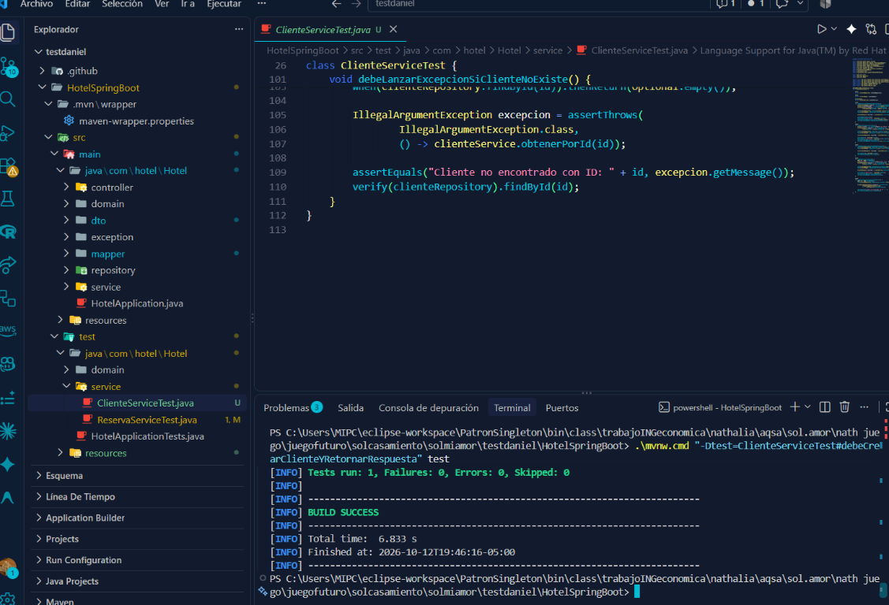
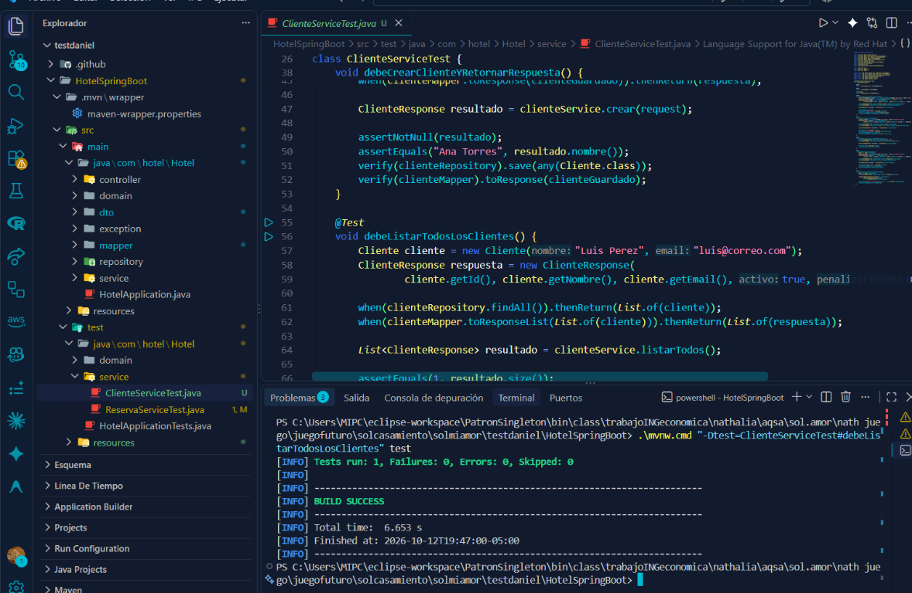
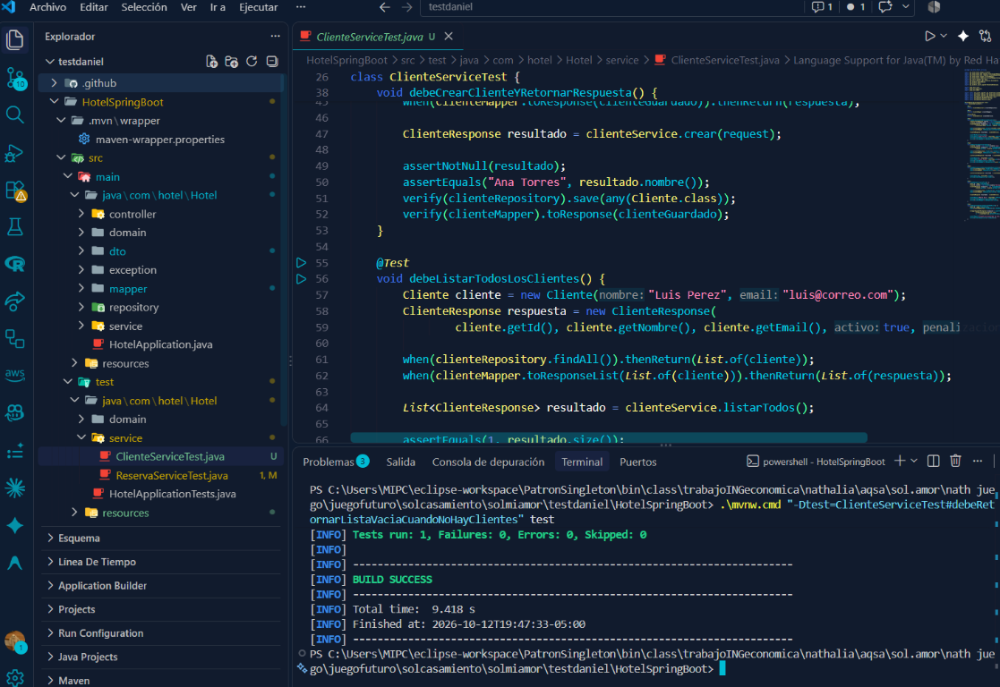
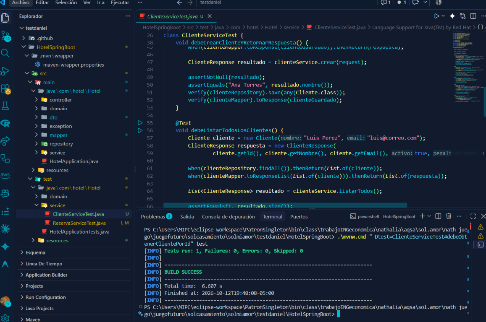
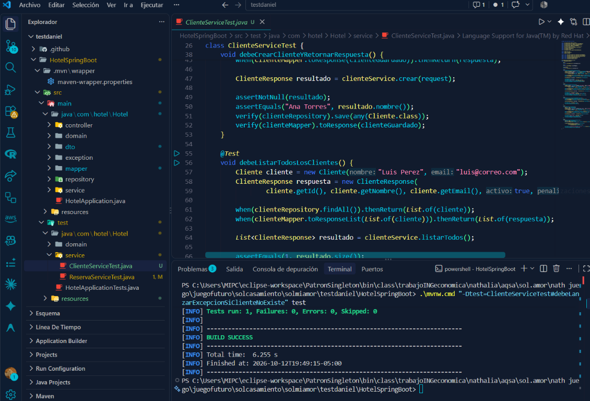

# Pruebas unitarias con JUnit 5 y Mockito

Este repositorio contiene un proyecto Spring Boot con cinco pruebas unitarias
nuevas para `ClienteService`. Las pruebas utilizan JUnit 5 y Mockito, sin
conectarse a una base de datos real.

## Proyecto

El código fuente se encuentra en [HotelSpringBoot](./HotelSpringBoot).

Para ejecutar todas las pruebas:

```powershell
cd HotelSpringBoot
.\mvnw.cmd test
```

Resultado validado: **8 pruebas ejecutadas, 0 fallos y 0 errores**.

## Cinco pruebas nuevas

### 1. Crear un cliente

Método: `debeCrearClienteYRetornarRespuesta`

Verifica que el servicio guarde un cliente y devuelva la respuesta
correspondiente.



### 2. Listar todos los clientes

Método: `debeListarTodosLosClientes`

Verifica que el servicio convierta y devuelva la lista de clientes encontrada.



### 3. Devolver una lista vacía

Método: `debeRetornarListaVaciaCuandoNoHayClientes`

Verifica el comportamiento cuando el repositorio no encuentra clientes.



### 4. Obtener un cliente por ID

Método: `debeObtenerClientePorId`

Verifica que el servicio encuentre un cliente por su identificador y lo
convierta en una respuesta.



### 5. Lanzar una excepción cuando no existe

Método: `debeLanzarExcepcionSiClienteNoExiste`

Verifica que el servicio lance `IllegalArgumentException` cuando el ID no
corresponde a ningún cliente.



## Ejecutar cada prueba por separado

```powershell
.\mvnw.cmd "-Dtest=ClienteServiceTest#debeCrearClienteYRetornarRespuesta" test
.\mvnw.cmd "-Dtest=ClienteServiceTest#debeListarTodosLosClientes" test
.\mvnw.cmd "-Dtest=ClienteServiceTest#debeRetornarListaVaciaCuandoNoHayClientes" test
.\mvnw.cmd "-Dtest=ClienteServiceTest#debeObtenerClientePorId" test
.\mvnw.cmd "-Dtest=ClienteServiceTest#debeLanzarExcepcionSiClienteNoExiste" test
```
